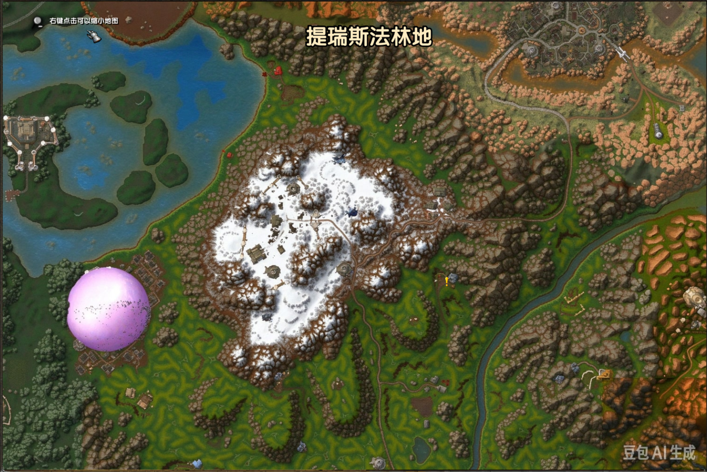
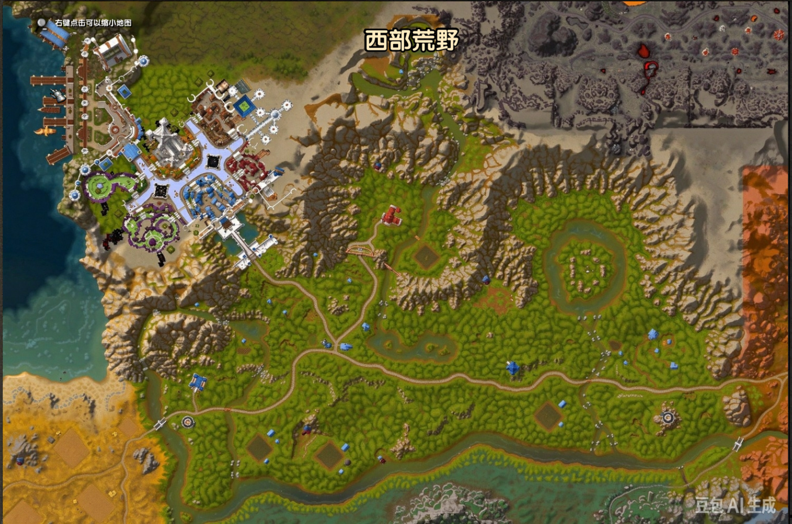
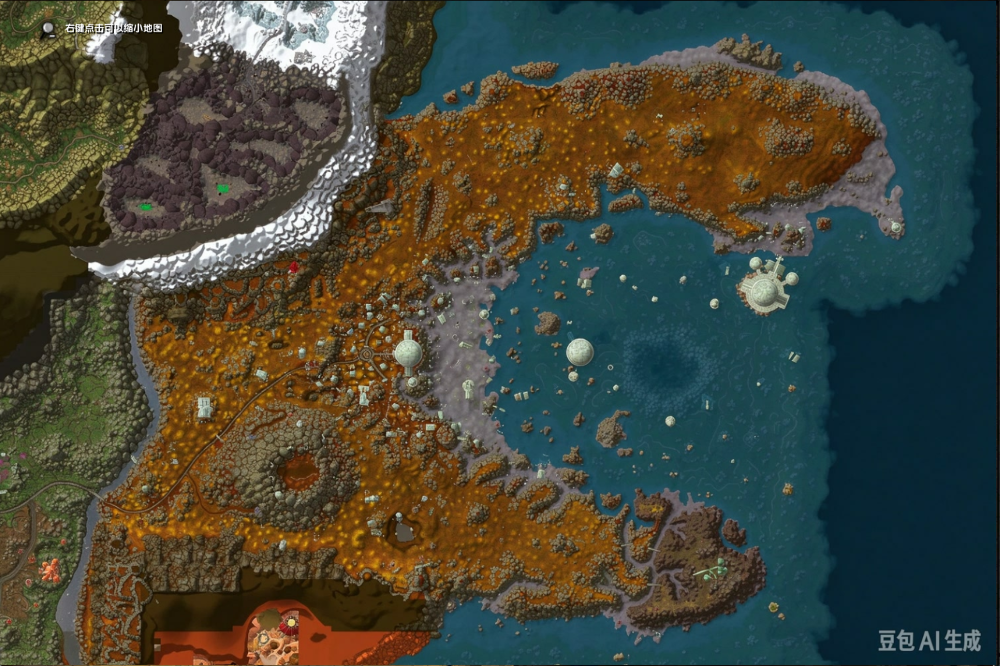

# EH_RealisticMap —— 世界地图「区域实景 / 图层彩绘」+ 世界迷雾接管

> **EvalHelp 的可选子插件**：配置窗（`/eh cfg`）→ 第 ⑦ 页「子插件」→ 勾选 `EH_RealisticMap` → `/reload`。
> 本插件 = 原来宿主「**关闭世界迷雾 → 区域实景贴图**」那一整块（表驱动实景渲染 + 接管守护 + 残留清理 +
> 编辑模式 + 自带节拍帧），2026-10-10 整族迁出来独立管理 —— 宿主里那个 `tools/WorldFog.lua` 已经不存在了。
> 命令口 = **`/erm`**（子命令与以前的 `/ehm mapfit <子命令>` **逐字同义**，换个前缀就会用）。

## 界面预览

| 提瑞斯法林地 | 西部荒野 |
| --- | --- |
|  |  |
| **区域实景整区一张**铺满地图帧（写 `OVERLAY` 绘制层 ⇒ 同组里优先级最高、盖住其它层）；北方那片雪原与幽暗城入口的紫色球体都是客户端自带美术，照旧画在实景之上 | 实景层之上照旧叠加**地图标注**（右侧「地图标注(N)」控制行随切图实时重绘）；标题「西部荒野」由客户端绘制 |

| 艾萨拉一带 |
| --- |
|  |
| 地形实拍拼接的**整区一张**：图幅比单一区域更大，周边地形（雪原 / 海岸 / 岛屿）一并可见 —— 这就是「不再看手绘示意图」的效果 |

> 📷 截图里右下角的「**豆包AI生成**」是素材自带的水印（已确认：有意保留，不再修图）。

## 它做什么

1. **整区图层（本插件的门面）—— 三档并列可切换**
   打开世界地图，把一整张区域图**铺满 1002×668 的地图帧**，并写在 **`OVERLAY` 绘制层**（同组内优先级最高）。
   三档任选（`/erm` 面板里那三行勾选，或 `/erm 图层 实景` / `/erm 图层 彩绘` / `/erm 图层 原始图`，**切换当场生效、不用 `/reload`**）：
   - **区域实景**（默认）：`media\WorldMapJpg\<图>_re.jpg` 的 **AI 高清地形实拍拼接图**，共 **52 张区域图**。
   - **原始图**（0.2.9 新增）：`media\WorldMapSource\<图>_src.jpg` —— **把客户端自己的地图美术合成成一张完整整图**
     （4×3 基础底图 + 区域块，位置 = 定位表值 + 你调的补偿）⇒ 就是游戏里「全探索」时的那张图，**53 张区域图全有**。
   - **图层彩绘**（0.2.0 新增）：`media\WorldMapPaint\<图>_cn.jpg` 的**游戏重绘风格**整区图，共 **41 张** —— 素材来自
     外部高清地图包 **UnrealMap**（12 块基础瓦片打底 + 区域块叠加 = 游戏里「全探索」时的画面）。
     那 11 张 UnrealMap 没有的自定义图（Hyjal / Lapidis / Gilneas / Icepoint / Northwind …）**自动交回客户端地图**。
   ★**两档的编辑补偿各存各的**（`editJpg` / `editPaint`），切换一个字都不动。
   ★**顶栏那颗快捷按钮**（0.2.1 新增）：打开地图后，「**缩小**」按钮的右边紧挨着一颗同款按钮，
   文字写的是「**切换到彩绘 / 实景 / 原始图**」（= 点一下会切到哪一档），**三档循环**，点一下当场切换。
   ★它只在总开关开着、且地图**没有最小化**时显示（跟着客户端那个「缩小」按钮一起显隐）。
   ★**主城已交回客户端**：暴风城 / 达纳苏斯 / 雷霆崖 / 奥格瑞玛 / 幽暗城 / 铁炉堡这六座城里，本插件
   **一帧都不画、也不碰客户端的层** —— 你看到的是客户端自带那张城图（含室内平面图）。

2. **世界迷雾接管（表驱动全渲染 + 守护）**
   按 S_WorldMap 区域表知道「这张图该有几块」，于是：**原生探索层全部藏掉** → **按表自己画** →
   **每一拍查「数量」与「存在性」**（客户端偷偷把层 `Show` 回来就再藏一次、超出本图块数的池位一律收起、
   我们自己的块被藏了就复位）。★**判不出就不动手**：一旦「枚举里认不出哪几块是我们画的」，本拍
   **一个字节都不碰**并如实出声 —— 宁可保留客户端原样，绝不画成空白图。

3. **残留图层清理**
   切到「本来就没有探索层数据」的图（世界地图 / 大陆板块图 / 无数据图）时，把上一张图留下的
   `WorldMapOverlay*` 池位**全部藏掉**（否则会叠在新地图上造成错乱）；切回有数据的图**全部还回**。

4. **编辑模式（本游戏专属坐标补偿）**
   客户端的地图内容与上游数据表**不同源**，个别区域会偏一点 —— 编辑模式给你逐块微调的口，
   补偿**只写本插件自己的存档**，并可烘成随包基线发给别人（见下）。

5. **只读体检（一条命令、零步骤）**
   残留体检 / 贴图探针 / 一句话结论，全只读；结果**只回显聊天框**。
   ★0.2.8 起本插件**不再有任何日志与取证环**（自动播报 / 落盘环 `/erm 自检` 已整条删除）。

## 怎么启用 / 开关与状态

- **启用**：第 ⑦ 页勾选这一行 → 弹「需要 /reload」确认窗 → 确定重载；勾选会同时把它写进**客户端插件清单**。
- **关掉**：取消勾选（同样要 `/reload` 才真正不载入）；关掉后插件**不碰地图一个字节**（关掉零动作）。
- **默认档**：**开 + 区域实景**（与迁移前一致）。
- ★**状态以客户端事实为准**：如果你是在**客户端自己的插件清单**里启用的它，第 ⑦ 页那一行会
  **自动同步**成「已载入（本会话可用）」并给出 `[打开面板]`，不会显示成「未启用（不载入）」；
  反过来，你手动取消勾选后**不会被自动勾回来**（客户端卸载要等 `/reload`，那一行会如实写「未启用（不载入）」）。

## 命令（`/erm`）

| 命令 | 作用 |
| --- | --- |
| `/erm` · `/erm ui` · `/erm 状态` | 打开插件面板 / 只读状态行（开关 · 编辑模式 · 图层 · 补偿条数 · 宿主桥 · 面板边框自证 · 顶栏快捷按钮自证） |
| `/erm swm on\|off` | 总开关（与面板上那个勾、第 ⑦ 页那一行**同一份真值**） |
| `/erm 编辑 on\|off` | 编辑模式开关 |
| `/erm 图层` | 图层状态（当前是哪一档 · 基线/贴图探针/负对照 · 本档补偿条数 · 实时几何读数） |
| `/erm 图层 实景` · `/erm 图层 彩绘` | **两档并列切换**（当场生效、不用 `/reload`；`/erm 图层 彩图` 只回一句「该层已删除」） |
| `/erm 残留` | 残留图层体检（本图数据 / 引擎自报条数 / 要藏几个 / 藏账 + 落盘历史） |
| `/erm 检查` | **一句话结论**：客户端的探索层到底有没有全藏干净（✅/❌/⚠️ 分档） |
| `/erm 贴图` | 贴图探针（自带那份每种写法各探一次 + **负对照**判可信度） |
| `/erm perf` | 性能两拍（渲染块数 / 写了几次 / 跳过几次） |
| `/erm 重复` | 同序号重复层体检 |
| `/erm 微调` · `/erm 箭头` | 位置箭头微调（选中后在列表底部点 ↑↓←→） |
| `/erm 编辑 配对` | 补偿与基线表的配对体检（孤儿 N 条 / 基础表已变 M 条） |
| `/erm 编辑 清` · `/erm 编辑 清全部` | 清掉**你自己的增量**（回落到插件基线；面板上要两次点击确认） |
| `/erm 编辑 重置插件 本图\|全部` | 连**插件基线**一起清（回原始表值） |

## 编辑模式怎么用

- 打开编辑模式后，地图上每块贴图带**序号角标**，地图右侧出现**贴图列表**：
  点行选中（可多选，选中的一起拖）· 滚轮逐行 · 右键行 = **显示/隐藏这一层**（只改显示，不动补偿数据）·
  行前红 `×` **左键 = 只清你的增量**（回落插件基线）/ **右键 = 连插件基线一起清**（回原始表值）。
- **拖动**：先在图上点一下**选中**它（那一下只选中、不会拖走），再按住左键拖动；多选则整组一起动。
  ★**右键 = 释放拖拽**（拖到一半找不到松手点时按右键即可放开）。
- **列表底部十排**（自上而下）：位置箭头 ↑↓←→ · 尺寸 宽−/宽+/高−/高+ · 选中集 `[全选][全清][归零选中]` ·
  重置清理 `[重置本图][重置全部]`（**两次点击确认**）· 原始贴图层 显示/隐藏 · 迷雾贴图层 显示/隐藏 ·
  迷雾透明度（100/75/50/25/10/0 循环）· 重置本图（含插件）· 重置全部（含插件）· **保存（写盘 + 重载）**。
- **一点 = 1 屏幕像素**，按住 **Shift** 点 = 10 像素（箭头与尺寸同一把尺子）；尺寸只对**单选一块**生效，
  拉伸的是这一块本身（UV 不动）。
- ★本客户端**只在 `/reload` 时写盘** ⇒ 调完一定要点最后的 **`[保存（写盘 + 重载）]`**（它走项目的通用
  确认窗，不会偷偷重载；聊天框会被清空是正常的）。

## 数据与存档

| 是什么 | 在哪 |
| --- | --- |
| **本插件自己的存档**（开关 / 编辑模式 / 逐块补偿） | `SavedVariables\EH_RealisticMap.lua` 的 **`EH_REALISTICMAP_CFG`**（宿主存档**只读**，一个字节都不写） |
| **定位基线**（每图一条 `{宽,高,偏移x,偏移y}`，**生成物**） | `MapOverlayJPGData.lua`（实景）· `MapOverlayPaintData.lua`（彩绘） |
| **插件偏移量基线**（发布给别人的矫正值，**生成物**） | `MapOverlayOffsetJPG.lua` / `MapOverlayOffsetPaint.lua`（生效次序 = 存档 > 文件 > 无） |
| **实景图库** | `media\WorldMapJpg\<图>_re.jpg`（52 张区域图；`_city\` 4 张主城图**不随包发货**，只留本机） |
| **彩绘图库**（0.2.0 新增） | `media\WorldMapPaint\<图>_cn.jpg`（41 张；素材派生自 UnrealMap 的高清地图贴图） |
| **原始图库**（0.2.9 新增） | `media\WorldMapSource\<图>_src.jpg`（53 张；把客户端自己的美术合成成整图，生成器 `tmp/gen_worldmapsource.js`） |
| **三语文案** | `Locales\{zhCN,enUS,ruRU}.lua` |

- ★**老用户无感迁移**：第一次载入会把宿主 `EvalHelp.lua` 里 `worldFogCfg` 的设置与编辑补偿
  **一次性、纯读**导入到本插件存档（标记 `importedV1`），**宿主里那份原样保留** —— 你之前调好的偏移量继续有效。
- ★**想把你的微调发给别人**：把存档里的补偿烘成插件基线即可
  （`node gen_mapoffset.js --jpg`，口令「同步偏移量」；详见根目录 `CLAUDE.md` 的发布段）。

## 已知边界（如实说）

- 本客户端那批原生 `WorldMapOverlay*` 纹理**在全局表里按名字找不到** ⇒ 客户端自己的内置探索纹理可能有
  **两三块残留**藏不掉。这是有意接受的取舍：**宁可留残留，也绝不去动区域对象**（动过就会把地图弄乱）。
- 「缩放大地图」的**透明度 < 1** 时，按 alpha 的判据会失准 ⇒ 本插件**整组不动手**（要这份清理就把透明度调回 1.00）。
- 表里没有的图（世界地图 / 大陆 / 城市）**不接管**：保持客户端原样，绝不画空白图。
  ★**彩绘那一档**另有 11 张自定义图（Hyjal / Lapidis / Gillijim / TelAbim / Gilneas / Icepoint /
  BlackstoneIsland / ThalassianHighlands / GrimReaches / Northwind / Moonwhisper）**没有素材** ⇒ 同样交回客户端地图。
- 实景素材为 AI 重绘版，右下角带「豆包AI生成」水印（有意保留）；**彩绘**素材来自 UnrealMap 的重绘贴图（无水印）。

## 文件

`EH_RealisticMap.toc` · `EH_RealisticMap.lua`（主源码）· `Locales\{zhCN,enUS,ruRU}.lua` ·
`MapOverlayJPGData.lua` · `MapOverlayOffsetJPG.lua` · `MapOverlayPaintData.lua` · `MapOverlayOffsetPaint.lua` ·
`media\WorldMapJpg\`（52 图 `<图>_re.jpg` + `_city\` 4 图不发货）· `media\WorldMapPaint\`（41 图 `<图>_cn.jpg`）·
`media\WorldMapSource\`（53 图 `<图>_src.jpg`）·
`preview\`（本文截图，**不随包发货**）。

- 开发记忆（判据 / 铁律 / 锚点 / 欠账）= 同目录 **`CLAUDE.md`**
- 改动记录 = 同目录 **`CHANGELOG.md`**
